  

  
  
  
  
  
  

---

# ⚡ Awesome Event Streaming & Ingestion

> 🚀 **A curated directory of high-throughput event ingestion engines, distributed message brokers, real-time stream processing frameworks, and cloud streaming platforms.**

Whether you are architecting a planetary-scale microservices fabric, building low-latency AI inference and LLM routing pipelines, ingesting telemetry from millions of IoT sensors, or streaming CDC (Change Data Capture) logs into modern data lakes, this repository provides a definitive, unbiased guide to both **managed SaaS platforms** and **self-hosted open-source projects**.

---

## 📑 Table of Contents

- [📊 Sector Overview & Market Dynamics](#-sector-overview--market-dynamics)
- [☁️ Managed SaaS & Cloud Platforms](#️-managed-saas--cloud-platforms)
- [🐙 Open-Source GitHub Projects](#-open-source-github-projects)
- [🧭 Architecture & Selection Matrix](#-architecture--selection-matrix)
- [🤝 How to Contribute](#-how-to-contribute)
- [📈 Star History](#-star-history)
- [📜 Disclaimer & License](#-disclaimer--license)

---

## 📊 Sector Overview & Market Dynamics

The global **Event Stream Processing & Real-Time Data Ingestion** market is valued at approximately **$28.5 Billion** and is projected to surpass **$74 Billion by 2030**, compounding at a rapid **CAGR of ~22.8%**, driven by the relentless demand for instantaneous AI inference, real-time analytics, fraud detection, and connected IoT ecosystems.

The sector exhibits **moderate concentration** at the foundational enterprise backbone layer—heavily anchored by hyperscale cloud platforms (Microsoft Azure, AWS, Google Cloud) and the de-facto Apache Kafka standard spearheaded by Confluent. However, the ecosystem displays **vibrant and aggressive peripheral fragmentation**: specialized modern challengers are emerging rapidly to capture latency-sensitive niches, including zero-JVM C++/Rust streaming engines (Redpanda, Vector), lightweight edge and IoT pub/sub protocols (MQTT, Zenoh, EMQX), and developer-friendly serverless pay-per-event architectures (Upstash).

---

## ☁️ Managed SaaS & Cloud Platforms

A comprehensive comparison of leading managed and serverless event streaming services, ranked in descending order by **Company Size / Valuation / Scale**.

| 🏢 Platform | 🏷️ Provider / Ecosystem | 💰 Specific Starting Pricing | 🎁 Specific Free Tier / Trial Limits | 📈 Company Scale (Valuation / Revenue) |
| :--- | :--- | :--- | :--- | :--- |
| **[Azure Event Hubs](https://azure.microsoft.com/en-us/products/event-hubs/)** | Microsoft Azure | **$0.015/hour** per Throughput Unit (~$11/mo base) + **$0.028 per 1M events** (Basic); Standard at **$0.03/hour** per TU (~$22/mo) | **30-Day Free Trial** with **$200 in Azure credits**; no perpetual standalone free tier | **$3.1 Trillion** (Market Cap) / **$245B+** Revenue |
| **[Google Cloud Pub/Sub](https://cloud.google.com/pubsub)** | Google Cloud | **$40.00 per TiB** ($0.039/GiB) for data ingestion and delivery; **$0.27/GiB-month** for storage | **Perpetual Free Tier**: First **10 GiB** message volume free every month + **90-day trial with $300 credits** | **$2.1 Trillion** (Market Cap) / **$307B+** Revenue |
| **[Amazon MSK](https://aws.amazon.com/msk/)** | Amazon Web Services | **$0.042/hour** (~$30.24/month) per `kafka.t3.small` broker (Provisioned); Serverless from **$0.75/cluster-hour** + **$0.10/GB** ingress | **3-Month Free Trial**: **750 hours/month** of single-broker `kafka.t3.small` cluster under AWS Free Tier | **$2.0 Trillion** (Market Cap) / **$575B+** Revenue |
| **[IBM MQ on Cloud](https://www.ibm.com/products/mq)** | IBM Cloud | **$0.278/hour** (~$200/month) for Reserved Small Queue Manager instance | **30-Day Free Trial** with **$200 IBM Cloud credits**; free perpetual Developer Edition for non-production local use | **$200+ Billion** (Market Cap) / **$62B+** Revenue |
| **[Confluent Cloud](https://www.confluent.io/confluent-cloud/)** | Confluent | **$0.00/hour** base (Basic Cluster) + **$0.13/GB ingress**, **$0.13/GB egress**, **$0.10/GB-month storage**, and **$0.015/partition-hour** | **30-Day Free Trial** with **$400 free usage credits** for new signups | **$7.5 Billion** (Market Cap - CFLT) / **$915M+** ARR |
| **[Aiven for Apache Kafka](https://aiven.io/kafka)** | Aiven | **$0.33/hour** (~$240/month) for Startup-4 plan (3 nodes, 4 GB RAM, 80 GB NVMe storage, 99.95% SLA) | **30-Day Free Trial** with **$300 credits** on account creation (no credit card required) | **$3.0 Billion** (Series D Valuation) / **$100M+** ARR |
| **[Solace PubSub+ Cloud](https://solace.com/products/event-broker/cloud/)** | Solace | **$0.05/service-hour** (~$36/month) for Developer/Nano instance; Standard production clusters start at **$380/month** | **Perpetual Free Tier**: Free Developer instance with **100 concurrent connections**, **50 msgs/sec**, and **1 GB storage** | **$1.0 Billion** (Estimated Valuation) / **$150M+** ARR |
| **[Redpanda Cloud](https://redpanda.com/cloud)** | Redpanda Data | **$0.00/hour** base (Serverless) + **$0.10/GB ingress**, **$0.10/GB egress**, **$0.10/GB-month storage**, and **$0.001/partition-hour** | **14-Day Free Trial** with **$100 serverless usage credits**; no credit card required | **$450 Million** (Series C Valuation) / Raised **$165M+** |
| **[HiveMQ Cloud](https://www.hivemq.com/pricing/)** | HiveMQ | **$1.50 per 1M messages** + **$0.15/GB data transfer** (Pay-as-you-go); Starter managed clusters from **$49/month** | **Perpetual Free Tier**: Connect up to **100 IoT devices**, **10 GB/month data transfer**, and **3-day retention** | **$200 Million** (Series A Valuation) / Market leader in MQTT |
| **[Upstash Kafka](https://upstash.com/pricing/kafka)** | Upstash | **$0.60 per 100,000 messages** ($0.000006/msg), capped at a maximum of **$120/month per topic** | **Perpetual Free Tier**: **10,000 messages/day** (~300,000 messages/mo), **256 MB data transfer/day**, 1 cluster | **$80 Million** (Series A Valuation, backed by a16z) |

---

## 🐙 Open-Source GitHub Projects

Self-hosted, transparent, and protocol-flexible event streaming engines, brokers, and ingestion pipelines. Sorted in descending order by **GitHub Star Count**.

1. **[Apache Kafka](https://github.com/apache/kafka)**   
   The industry-standard distributed event streaming platform. Provides ultra-high-throughput, fault-tolerant, durable log storage with strong ordering semantics. Modern KRaft mode eliminates ZooKeeper dependencies.  
   *Best for:* Mission-critical enterprise streaming backbones, CDC pipelines, and large-scale data lake ingestion.

2. **[Apache Flink](https://github.com/apache/flink)**   
   Stateful stream processing framework over unbounded and bounded data streams. Features low event-latency, exactly-once processing guarantees, and robust state and checkpoint management.  
   *Best for:* Complex real-time event analytics, streaming CEP (Complex Event Processing), and dynamic sliding-window calculations.

3. **[Vector](https://github.com/vectordotdev/vector)**   
   High-performance observability and event data pipeline written in Rust. Ingests, transforms, and routes logs, metrics, and event streams with memory safety and minimal resource footprint.  
   *Best for:* High-throughput log and telemetry ingestion, routing, and schema transformation before downstream brokers.

4. **[Apache RocketMQ](https://github.com/apache/rocketmq)**   
   Cloud-native distributed messaging and streaming platform designed for low-latency, massive message accumulation, and financial-grade reliability. Developed originally by Alibaba.  
   *Best for:* E-commerce transaction processing, ordered message delivery, and large-scale enterprise messaging backplanes.

5. **[NATS Server](https://github.com/nats-io/nats-server)**   
   Connective technology for adaptive edge, IoT, and cloud distributed systems written in Go. Features JetStream for persistence, key-value storage, and object streaming at millions of msgs/sec.  
   *Best for:* Microservices pub/sub, edge computing, dynamic multi-cloud meshes, and lightweight persistent event logs.

6. **[EMQX](https://github.com/emqx/emqx)**   
   World's most scalable open-source MQTT message broker for IoT and industrial automation. Written in Erlang/OTP, capable of handling 100M+ concurrent MQTT connections in a single cluster.  
   *Best for:* Massive IoT fleet telemetry ingestion, smart cities, and vehicle-to-everything (V2X) streaming.

7. **[Apache Pulsar](https://github.com/apache/pulsar)**   
   Distributed pub-sub messaging and streaming platform separating computation from storage (Apache BookKeeper). Natively supports multi-tenancy, tiered cold storage, and geo-replication.  
   *Best for:* Multi-tenant SaaS architectures, geo-distributed streaming clusters, and long-term event retention.

8. **[RabbitMQ](https://github.com/rabbitmq/rabbitmq-server)**   
   Extremely mature, battle-tested message broker supporting AMQP 0-9-1, AMQP 1.0, MQTT, and STOMP. Offers flexible exchange-based routing, dead-letter exchanges, and quorum queues.  
   *Best for:* Microservices asynchronous RPC, complex message routing, and reliable transactional worker queues.

9. **[Redpanda](https://github.com/redpanda-data/redpanda)**   
   Modern Kafka-compatible streaming engine engineered in C++ using the Seastar thread-per-core asynchronous architecture. Zero JVM, zero ZooKeeper, delivering deterministic sub-millisecond tail latencies.  
   *Best for:* Kafka workloads requiring sub-millisecond p99 latencies, simplified DevOps, and high hardware density.

10. **[Eclipse Mosquitto](https://github.com/eclipse-mosquitto/mosquitto)**   
    Lightweight open-source message broker implementing MQTT protocols 5.0, 3.1.1, and 3.1 written in C. Ultra-low RAM footprint makes it the universal standard on embedded devices.  
    *Best for:* Embedded Linux gateways, Raspberry Pi appliances, home automation, and constrained edge hardware.

11. **[ZeroMQ (libzmq)](https://github.com/zeromq/libzmq)**   
    Universal high-performance asynchronous messaging library providing socket-style communication primitives without a centralized broker daemon over inproc, IPC, TCP, and PGM.  
    *Best for:* High-frequency trading (HFT), high-throughput intra-process IPC, and ultra-low-latency peer-to-peer piping.

12. **[Redpanda Connect (formerly Benthos)](https://github.com/redpanda-data/connect)**   
    High-performance stream processor and data ingestion tool in Go. Connects diverse sources and sinks with declarative YAML pipelines, dynamic routing, and stateless transformations.  
    *Best for:* Resilient ETL glue, protocol bridging, event deduplication, and streaming ingestion into Kafka/Redpanda.

13. **[Fluent Bit](https://github.com/fluent/fluent-bit)**   
    Super fast, lightweight log and event processor and forwarder for Linux, macOS, and Windows. Highly optimized C codebase designed for Kubernetes and containerized edge workloads.  
    *Best for:* Ingesting logs and events across Kubernetes clusters and forwarding to Kafka, Elasticsearch, or cloud sinks.

14. **[VerneMQ](https://github.com/vernemq/vernemq)**   
    High-performance, distributed MQTT message broker developed in Erlang. Scales horizontally across cluster nodes to handle massive IoT telemetry ingress with high fault tolerance.  
    *Best for:* Distributed IoT fleets and industrial telemetry with horizontal clustering requirements.

15. **[Eclipse Zenoh](https://github.com/eclipse-zenoh/zenoh)**   
    Zero-overhead pub/sub, store/query, and distributed compute protocol in Rust. Bridges transparently across MQTT, ROS 2, DDS, and Kafka with minimal wire protocol overhead.  
    *Best for:* Robotics, autonomous driving, WAN-spanning distributed meshes, and edge-to-cloud telemetry.

16. **[Apache ActiveMQ](https://github.com/apache/activemq)**   
    Classic multi-protocol messaging server supporting JMS 1.1/2.0, AMQP, MQTT, and STOMP. The modern ActiveMQ Artemis project provides an asynchronous non-blocking architecture.  
    *Best for:* Traditional Java enterprise middleware, JMS integration, and multi-protocol legacy system bridging.

17. **[HiveMQ Community Edition](https://github.com/hivemq/hivemq-community-edition)**   
    Open-source Java-based MQTT broker supporting MQTT 3.x and MQTT 5.0 with an extensible plugin architecture and open APIs.  
    *Best for:* Enterprise MQTT testing, custom IoT plugin development, and standard MQTT compliance.

18. **[Busbar](https://github.com/GetBusbar/busbar)**   
    Single-binary AI inference gateway and event router. Distributes, validates, and fails over prompt/completion streams across LLM providers (Anthropic, OpenAI, Gemini, Cohere, Bedrock).  
    *Best for:* Real-time AI stream ingestion, LLM fallback routing, and token budget enforcement.

---

## 🧭 Architecture & Selection Matrix

| Workload Requirement | Recommended Solutions | Rationale |
| :--- | :--- | :--- |
| **High-Throughput Persistent Log Backbone** | `Apache Kafka`, `Redpanda`, `Confluent Cloud` | Strict partition-level ordering, disk durability, massive ecosystem connectors. |
| **Microservices Messaging & Complex Routing** | `RabbitMQ`, `NATS Server` | Exchange bindings, AMQP pattern matching, request-reply semantics, lightweight footprint. |
| **Massive IoT Telemetry Ingestion** | `EMQX`, `Eclipse Mosquitto`, `HiveMQ Cloud` | High concurrent MQTT connections, low packet overhead, QoS delivery guarantees. |
| **Stateful Stream Processing & Analytics** | `Apache Flink` | Sub-second stateful windows, complex event processing, exactly-once stream semantics. |
| **Observability & Log Ingestion Pipeline** | `Vector`, `Fluent Bit`, `Redpanda Connect` | High wire throughput, minimal CPU/memory overhead, rich input/output plugin ecosystem. |
| **Edge-to-Cloud & Robotics Streaming** | `Eclipse Zenoh`, `ZeroMQ` | Sub-millisecond peer-to-peer transport, wire efficiency, minimal broker overhead. |

---

## 🤝 How to Contribute

Contributions are warmly welcomed! Help keep this ecosystem guide fresh, accurate, and comprehensive:

1. 🍴 **Fork the repository** to your personal GitHub account.
2. 🌿 **Create a feature branch** (`git checkout -b feat/add-awesome-streaming-tool`).
3. ✏️ **Add or edit entries** following the tabular structure for SaaS or the star-ranked format for open source.
4. 📝 **Ensure high-quality entries**: Include accurate pricing, official links, and objective descriptions.
5. 🚀 **Submit a Pull Request** with a brief overview of what you added or updated.

---

## 📈 Star History

---

## 📜 Disclaimer & License

- **Disclaimer**: This repository is a community-maintained curated index. Trademarks and product names belong to their respective owners. Mention does not constitute an endorsement.
- **License**: Released under the [MIT License](file:///C:/Users/ishan/Documents/Projects/Awesome-Event-Streaming-Ingestion/LICENSE).
